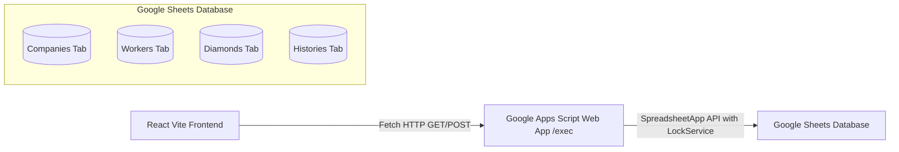

# DIVY IMPEX - Google Sheets + Google Apps Script Backend Guide

This guide walks you through setting up a zero-cost cloud backend for **DIVY IMPEX** using **Google Sheets** as the database and **Google Apps Script** as the serverless REST API.

---

## 🏗️ Architecture Overview



- **Frontend**: Calls Google Apps Script Web App endpoint.
- **Backend (`Code.gs`)**: Handles requests via `doGet(e)` and `doPost(e)`, performs CRUD operations, logs actions, and locks concurrent writes.
- **Database (Spreadsheet)**: Stores tables across 4 dedicated sheets with headers.

---

## 📋 Step-by-Step Setup Guide

### Step 1: Create a Google Spreadsheet
1. Open [Google Sheets](https://sheets.new).
2. Rename the spreadsheet to **`DIVY IMPEX Database`**.

---

### Step 2: Open Google Apps Script Editor
1. In the Google Sheet top menu, click **Extensions** > **Apps Script**.
2. A new tab will open with the script editor.
3. Rename the project from *Untitled project* to **`DIVY-IMPEX-BACKEND`** (top left).

---

### Step 3: Paste the Backend Code
1. In the Apps Script editor, open the file named `Code.gs`.
2. Clear any default code inside it.
3. Copy the entire content from the project's [`backend/Code.gs`](./Code.gs) file and paste it into `Code.gs`.
4. Press **Ctrl + S** (or click the disk icon) to save.

---

### Step 4: Run Initial Database Setup
1. In the toolbar at the top of the Apps Script editor, look for the function dropdown (next to "Debug").
2. Select **`setupDatabase`**.
3. Click **Run**.
4. **Authorize permissions**:
   - Google will show an *"Authorization Required"* dialog.
   - Click **Review permissions**.
   - Choose your Google account.
   - If prompted with *"Google hasn't verified this app"*, click **Advanced** (bottom left), then click **Go to DIVY-IMPEX-BACKEND (unsafe)**.
   - Click **Allow**.
5. Switch back to your Google Spreadsheet tab! You will see 4 stylized sheets auto-generated:
   - `Companies`
   - `Workers`
   - `Diamonds`
   - `Histories`

---

### Step 5: Deploy as a Web App (Public API)
1. In the Apps Script editor, click the blue **Deploy** button (top right) > **New deployment**.
2. In the modal:
   - Next to *Select type*, click the gear icon ⚙️ and choose **Web app**.
   - **Description**: `DIVY IMPEX Production API v1`
   - **Execute as**: `Me (your-email@gmail.com)` *(Important!)*
   - **Who has access**: `Anyone` *(Important so frontend can communicate without Google sign-in prompt)*
3. Click **Deploy**.
4. Copy the **Web App URL**. It looks like:
   ```
   https://script.google.com/macros/s/AKfycbxXXXXXXXXXXXXXXXXXXXXXXXXXXXXXXX/exec
   ```
   *(Note: It must end in `/exec`, NOT `/dev`)*.

---

### Step 6: Connect your React Frontend
1. In your project root (`c:\Siba\DIVY-IMPEX`), create a file named `.env` (or copy from `.env.example`):
   ```bash
   cp .env.example .env
   ```
2. Open `.env` and paste your Web App URL:
   ```env
   VITE_GOOGLE_SCRIPT_URL=https://script.google.com/macros/s/AKfycbxXXXXXXXXXXXXXXXXXXXXXXXXXXXXXXX/exec
   ```
3. Restart your Vite development server:
   ```bash
   npm run dev
   ```
4. Now, all company additions, worker assignments, diamond batches, and QC verification updates will save directly to your Google Sheet!

---

## 🗄️ Database Tables & Schema

| Sheet Tab | Columns (Row 1 Headers) |
|---|---|
| **Companies** | `id`, `name`, `code`, `contactPerson`, `phone`, `email`, `status`, `address` |
| **Workers** | `id`, `employeeId`, `name`, `department`, `phone`, `status` |
| **Diamonds** | `id`, `barcode`, `companyId`, `companyCode`, `companyName`, `size`, `weight`, `actualWeight`, `receivedDate`, `receivedBy`, `assignedWorkerId`, `assignedWorkerName`, `assignedDate`, `status`, `completedDate`, `completedBy`, `depositedDate`, `verifiedDate`, `verifiedBy`, `remarks` |
| **Histories** | `id`, `diamondId`, `barcode`, `action`, `performedBy`, `date`, `time`, `remarks` |

---

## ⚡ Important Developer Notes

1. **When updating Code.gs**:
   - Whenever you change code in `Code.gs`, click **Deploy** > **Manage deployments** > Click the edit pencil icon ✏️ > Select **New version** under Version dropdown > Click **Deploy**. (Google Apps Script only updates the `/exec` URL when a new version is created).
2. **Concurrency / Race Conditions**:
   - `Code.gs` utilizes `LockService.getScriptLock()` with a 20-second timeout to prevent conflicting writes if two operators record diamonds at the same second.
3. **CORS Handling**:
   - React sends POST payloads using `Content-Type: text/plain;charset=utf-8` to bypass preflight `OPTIONS` blocks that Google Apps Script does not natively support.
